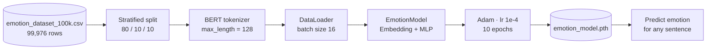

<div align="center">

# 🎭 Emotion Classifier

**A lightweight PyTorch model that reads a sentence and tells you how it feels.**

Seven emotion classes · 100K training texts · BERT tokenizer · ~2M-parameter network · 99.6% validation accuracy

[](https://colab.research.google.com/github/Prateek-Kumar-Anand/Experimenting-with-AI/blob/main/emotion_classifier.ipynb)


</div>

---

## Contents

- [Overview](#overview)
- [At a Glance](#at-a-glance)
- [Pipeline](#pipeline)
- [Dataset](#dataset)
- [Preprocessing](#preprocessing)
- [Model Architecture](#model-architecture)
- [Training](#training)
- [Results](#results)
- [Quick Start](#quick-start)
- [Using the Trained Model](#using-the-trained-model)
- [Project Structure](#project-structure)
- [Notes and Limitations](#notes-and-limitations)
- [Ideas for Next Steps](#ideas-for-next-steps)

---

## Overview

This project classifies short, informal text, the kind you'd find in chats and social posts, into one of **seven emotions**. The notebook walks through the full machine-learning workflow end to end:

1. Load a 100K-row emotion dataset
2. Create stratified train / validation / test splits
3. Tokenize text with the `bert-base-uncased` tokenizer
4. Train a compact embedding-based neural network from scratch
5. Save the weights and run live predictions on your own sentences

Rather than fine-tuning a large transformer, the model uses BERT's **vocabulary only** (the tokenizer) and learns its own small embedding layer. The result is a model of about **7.5 MB** that trains quickly and still reaches very high validation accuracy.

## At a Glance

| | |
|---|---|
| **Task** | Multi-class text classification (7 emotions) |
| **Framework** | PyTorch, 🤗 `transformers`, 🤗 `datasets`, scikit-learn, pandas |
| **Tokenizer** | `bert-base-uncased` (vocab size 30,522) |
| **Model** | Embedding → masked mean pooling → MLP |
| **Parameters** | 1,962,631 (≈ 7.49 MB in fp32) |
| **Training data** | 79,980 texts |
| **Best validation accuracy** | **99.64%** (epoch 10) |
| **Runs on** | Google Colab, CPU is enough |

## Pipeline



## Dataset

The data is a custom 100K-sample emotion dataset hosted in the author's GitHub repository:

```
https://raw.githubusercontent.com/Prateek-Kumar-Anand/Experimenting-with-AI/refs/heads/main/custom_datasets/emotion_dataset_100k.csv
```

**Shape:** 99,976 rows × 4 columns

| Column | Description |
|---|---|
| `id` | Unique row identifier |
| `text` | The raw sentence, with slang, emoji, and casual punctuation |
| `label` | Emotion name, such as `joy`, `anger`, `surprise` or `neutral` |
| `label_id` | Integer class ID, `0` to `6` |

**Sample rows**

| id | text | label | label_id |
|---|---|---|---|
| 1 | Ok, I updated my laptop. regular afternoon | neutral | 6 |
| 2 | Rn, on my way lol. 👌 | neutral | 6 |
| 3 | My teacher marked me wrong when I was right an… | anger | 2 |
| 4 | WOOO THE WHOLE FAMILY IS AT MY PLACE TONIGHT. … | joy | 0 |
| 5 | Today, noted. | neutral | 6 |

**Label mapping.** There are 7 classes, `label_id` 0–6. The IDs observed in the notebook output are `0 → joy`, `2 → anger`, `4 → surprise` and `6 → neutral`. The full mapping is rebuilt from the CSV at inference time (see [Using the Trained Model](#using-the-trained-model)).

## Preprocessing

### Splitting

The data is split **80 / 10 / 10** with `train_test_split`. Both splits are **stratified on `label`** and use `random_state=42`, so every emotion keeps the same proportion in each set and the results can be reproduced.

| Split | Rows | Share |
|---|---:|---:|
| Train | 79,980 | 80% |
| Validation | 9,998 | 10% |
| Test | 9,998 | 10% |

The splits are also written to `train.csv`, `validate.csv` and `test.csv`.

### Tokenization

Each split is converted to a Hugging Face `DatasetDict` and tokenized with `BertTokenizer.from_pretrained("bert-base-uncased")`:

```python
def tokenize_function(batch):
    return tokenizer(
        batch["text"],
        padding="max_length",
        truncation=True,
        max_length=128,
    )
```

Every sentence becomes a fixed-length sequence of **128 tokens**. The tokenizer adds `[CLS]` and `[SEP]`, then pads with `0`. Along with `input_ids` it returns an `attention_mask`, which marks real tokens as `1` and padding as `0`.

After tokenization the helper columns (`id`, `text`, `label`, `__index_level_0__`) are dropped, and the data is set to PyTorch tensor format. Each example then holds exactly four fields:

```
['label_id', 'input_ids', 'token_type_ids', 'attention_mask']
```

### Batching

Three `DataLoader`s serve the data with a **batch size of 16**. Only the training loader is shuffled. A single batch has these shapes:

| Tensor | Shape |
|---|---|
| `input_ids` | `[16, 128]` |
| `attention_mask` | `[16, 128]` |
| `token_type_ids` | `[16, 128]` |
| `label_id` | `[16]` |

## Model Architecture

`EmotionModel` is a small bag-of-embeddings classifier. Word vectors are averaged over the real tokens of a sentence, and a two-layer MLP then maps that average to the emotion classes.

```
input_ids  [B, 128]
    │
    ▼
Embedding(30522 → 64)                    →  [B, 128, 64]
    │
    ▼
Masked mean pooling (attention_mask)     →  [B, 64]
    │
    ▼
Linear(64 → 128) + ReLU                  →  [B, 128]
    │
    ▼
Linear(128 → 7)                          →  [B, 7]   (logits)
```

```python
class EmotionModel(nn.Module):
    def __init__(self, vocab_size):
        super().__init__()
        self.embedding = nn.Embedding(vocab_size, 64)
        self.fc1 = nn.Linear(64, 128)
        self.relu = nn.ReLU()
        self.fc2 = nn.Linear(128, 7)

    def forward(self, input_ids, attention_mask):
        x = self.embedding(input_ids)
        mask = attention_mask.unsqueeze(-1).float()
        x = (x * mask).sum(dim=1) / mask.sum(dim=1).clamp(min=1)
        x = self.relu(self.fc1(x))
        return self.fc2(x)
```

**Why masked mean pooling?** Most of each 128-token sequence is padding. Multiplying by the attention mask and dividing by the number of real tokens means padding never dilutes the sentence representation.

**Size**

| Layer | Parameters |
|---|---:|
| Embedding (30,522 × 64) | 1,953,408 |
| `fc1` (64 → 128) | 8,320 |
| `fc2` (128 → 7) | 903 |
| **Total** | **1,962,631** |

That comes to about **7.49 MB** in fp32.

## Training

| Setting | Value |
|---|---|
| Optimizer | Adam |
| Learning rate | `1e-4` |
| Loss | `CrossEntropyLoss` |
| Epochs | 10 |
| Batch size | 16 |
| Device | CPU |

Each epoch runs a training pass followed by a validation pass (`model.eval()` with `torch.no_grad()`). It prints the average training loss, average validation loss and validation accuracy.

## Results

| Epoch | Train Loss | Val Loss | Val Accuracy |
|:---:|:---:|:---:|:---:|
| 1 | 1.1963 | 0.5771 | 83.35% |
| 2 | 0.3581 | 0.2076 | 94.20% |
| 3 | 0.1419 | 0.0980 | 97.16% |
| 4 | 0.0709 | 0.0562 | 98.43% |
| 5 | 0.0417 | 0.0374 | 98.96% |
| 6 | 0.0275 | 0.0277 | 99.21% |
| 7 | 0.0196 | 0.0221 | 99.35% |
| 8 | 0.0148 | 0.0183 | 99.46% |
| 9 | 0.0115 | 0.0158 | 99.60% |
| 10 | **0.0092** | **0.0135** | **99.64%** |

Training and validation loss fall together across all ten epochs, with no sign of the validation loss turning back up. Accuracy was still creeping up at epoch 10, so more epochs would likely give small further gains.

**Example prediction**

```
> Hellow
Predicted class: 6
Predicted emotion: neutral
```

## Quick Start

### Option 1: Run in Colab

Click the **Open in Colab** badge at the top and choose *Runtime → Run all*. No setup is needed.

### Option 2: Run locally

```bash
# 1. Clone the repository
git clone https://github.com/Prateek-Kumar-Anand/Experimenting-with-AI.git
cd Experimenting-with-AI

# 2. Install dependencies
pip install torch pandas scikit-learn datasets transformers jupyter

# 3. Launch the notebook
jupyter notebook emotion_classifier.ipynb
```

**Requirements**

| Package | Used for |
|---|---|
| `torch` | Model, training loop, `DataLoader` |
| `pandas` | Loading and saving CSVs |
| `scikit-learn` | Stratified train / validation / test split |
| `datasets` | `Dataset` / `DatasetDict` and fast `.map()` tokenization |
| `transformers` | `BertTokenizer` |

The notebook was run on Python 3.13 in Google Colab with `transformers 5.20.2`.

## Using the Trained Model

After training, the notebook saves the weights with `torch.save(model.state_dict(), "emotion_model.pth")`. The standalone snippet below loads them and classifies a sentence. It reuses the `EmotionModel` class from [Model Architecture](#model-architecture) and builds the label map from the dataset CSV.

```python
import pandas as pd
import torch
from transformers import BertTokenizer

# 1. Rebuild the model and load the saved weights
tokenizer = BertTokenizer.from_pretrained("bert-base-uncased")
model = EmotionModel(tokenizer.vocab_size)          # class defined above
model.load_state_dict(torch.load("emotion_model.pth", map_location="cpu"))
model.eval()

# 2. Rebuild the id -> label mapping from the dataset
df = pd.read_csv("emotion_dataset_100k.csv")        # or the raw GitHub URL
id_to_label = dict(zip(df["label_id"], df["label"]))

# 3. Predict
text = "WOOO the whole family is at my place tonight!"
inputs = tokenizer(
    text,
    return_tensors="pt",
    padding="max_length",
    truncation=True,
    max_length=128,
)

with torch.no_grad():
    logits = model(inputs["input_ids"], inputs["attention_mask"])

predicted_class = torch.argmax(logits, dim=1).item()
print("Predicted emotion:", id_to_label[predicted_class])
```

## Project Structure

```
Experimenting-with-AI/
├── emotion_classifier.ipynb        # The full notebook: data → model → inference
└── custom_datasets/
    └── emotion_dataset_100k.csv    # 100K labelled emotion texts

Generated when the notebook runs
├── train.csv                       # 79,980 rows
├── validate.csv                    # 9,998 rows
├── test.csv                        # 9,998 rows
└── emotion_model.pth               # Trained weights (state_dict)
```

## Notes and Limitations

- **The test set is not evaluated yet.** `test.csv` and `test_loader` are created, but the reported 99.64% is the **validation** accuracy. For an unbiased final figure, run the test split once through the finished model.
- **Accuracy this high deserves a closer look.** A small embedding-average model reaching 99.6% suggests the classes are very separable in this dataset. Performance on text from other sources, with sarcasm, mixed feelings or a different style, may be noticeably lower.
- **Word order is ignored.** Mean pooling treats a sentence as a bag of words, so it cannot tell "not happy" from "happy" by structure alone.
- **BERT is used for its tokenizer only.** `BertModel` is imported but never used, so no pretrained BERT weights are involved.
- **Inference needs a label map.** The notebook rebuilds `id_to_label` from the dataset, so the CSV (or a saved copy of the mapping) must be available when you predict.
- **Per-class metrics are not reported.** Only overall accuracy and loss are tracked, so it's unknown whether any single emotion is weaker than the others.

## Ideas for Next Steps

- Evaluate on the held-out test set and add a confusion matrix with per-class precision, recall and F1
- Save the label mapping to a small JSON file next to the weights
- Add an LSTM/GRU or a small Transformer encoder to capture word order
- Fine-tune a pretrained model such as DistilBERT and compare it against this baseline
- Test on an out-of-domain emotion dataset to measure generalization
- Wrap inference in a small Gradio or Streamlit demo

---

<div align="center">

Made with ❤️ by [Prateek Kumar Anand](https://github.com/Prateek-Kumar-Anand) · Part of the *Experimenting with AI* series

</div>
